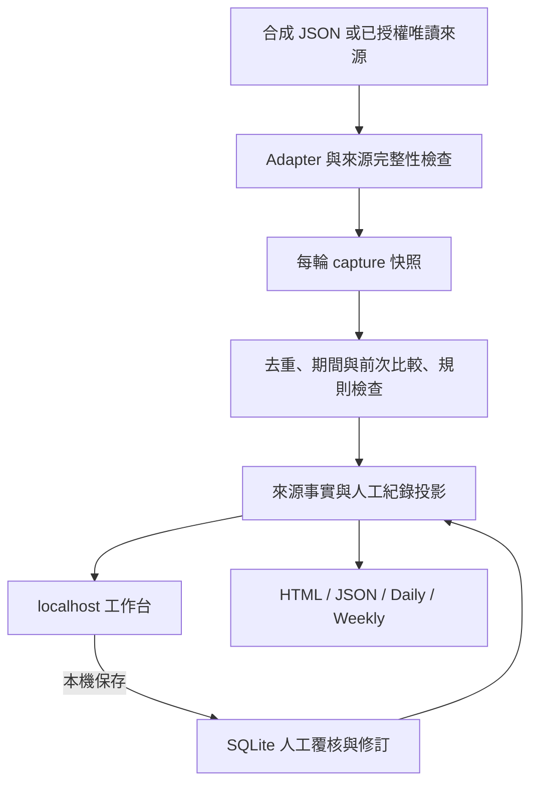

# PSIRT Workbench 架構

此文件描述去識別分享版的工程結構。附帶資料為合成範例，沒有繼承公司連線、資料庫或歷史快照。

## 資料流

## 邊界與責任

| 層 | 主要位置 | 責任 |
|---|---|---|
| 來源 | `scripts/psirt_ops/adapters.py` | 取得來源、記錄範圍與分頁完整性；不直接產生正式安全判定 |
| 執行與歷史 | `scripts/psirt_ops/pipeline.py`、`scripts/psirt_daily/` | 隔離輸出、保存快照、比較相容基準、產生新批次 |
| 分析 | `statistics.py`、`dt_statistics.py`、`sf_triage.py`、`mail_triage.py` | 定義計數與規則建議；保留 Unknown、FAILED、PARTIAL |
| 人工資料 | `scripts/psirt_casework/store.py` | 本機 SQLite 保存、版本衝突檢查、操作去重、修訂及一致備份 |
| 投影 | `projection.py`、`inbox.py`、`effective.py` | 合併來源與人工紀錄供工作頁及報告使用，不覆寫來源快照 |
| 本機服務 | `scripts/psirt_casework/service.py` | 單人 loopback HTTP、允許路由、Origin／token 檢查、服務識別 |
| 畫面與報告 | `web.py`、`html_report.py`、`reports.py` 與 `assets/` | 來源時間、範圍、明細、表單、可追溯批次報告 |

## 保存與重跑

示範預設資料根目錄為 `runtime/demo/`。每輪報告放入新的 `runs/<run-id>/`，包含來源快照、manifest 與產物。重新產報不覆寫舊報告。

人工資料另存在該根目錄下的 `casework/worklog.sqlite3`。保存帶有預期版本與操作識別碼；過期版本須回報衝突，同一操作重送不能重複累計。備份使用 SQLite 一致備份機制，不應任意複製寫入中的主檔而漏掉 WAL。

三個操作要分清楚：

- **開啟工作台**：讀取已有批次，啟動或重用該根目錄的本機服務。
- **重建報告**：由已有來源快照及目前人工紀錄產生新報告，沒有取得最新公司資料。
- **重新取數**：明確啟用 live adapter，向設定來源取數；本套件示範入口不執行此步驟。

統計同時保存來源時間及比較依據。「查詢期間新增」、「本週新增」與「相較上次新增」不是同一個數字。CVE、finding、DT project 與公司產品也不是相同單位；沒有產品對應證據就不計為產品數。

## 技術選擇與實際限制

Python 標準庫、SQLite 與原生 HTML／JS 可讓本機工作流直接重建；前端資產在本機，不依賴執行時 CDN。Linux／WSL 的檔案鎖與權限是此版的執行前提，因此不是 Windows 原生 Python 的相容性承諾。

目前是單人本機架構。未提供企業 SSO、使用者角色權限、租戶隔離、正式部署、跨機同步或營運維護機制。未接入 LLM／Agent／Herdr。若未來升級為團隊平台，需先定義帳號、權限、稽核、保存期限、遷移與部署規格，不能只把服務綁定改為 `0.0.0.0`。

來源與建議都可能不完整。資料收集失敗時仍可閱讀既有紀錄，但畫面必須顯示資料時間與本輪失敗，不得把舊報告當成本輪成功。正式產品影響與修復完成仍需人工核對證據。
